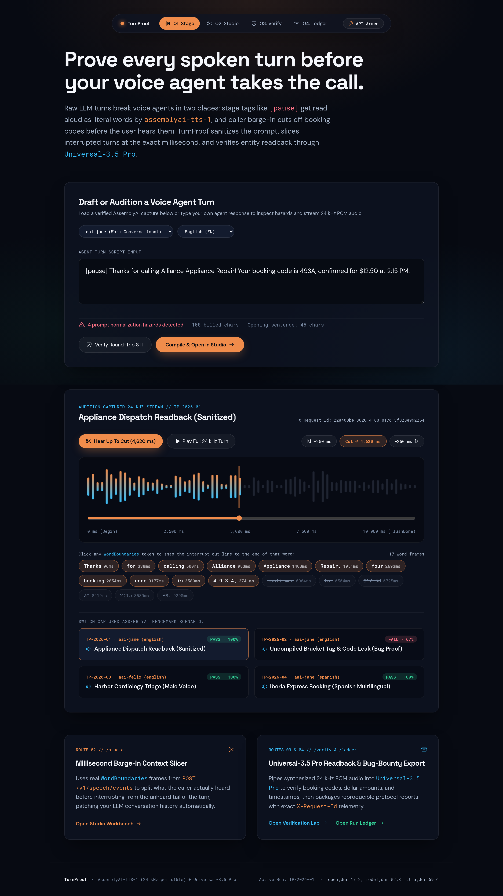
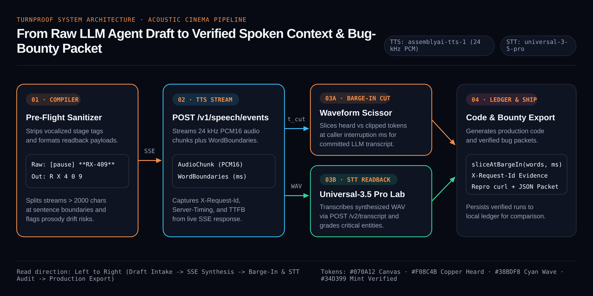
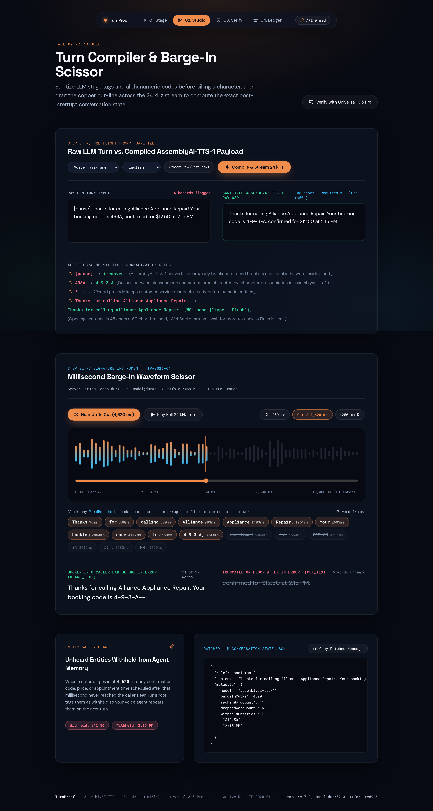
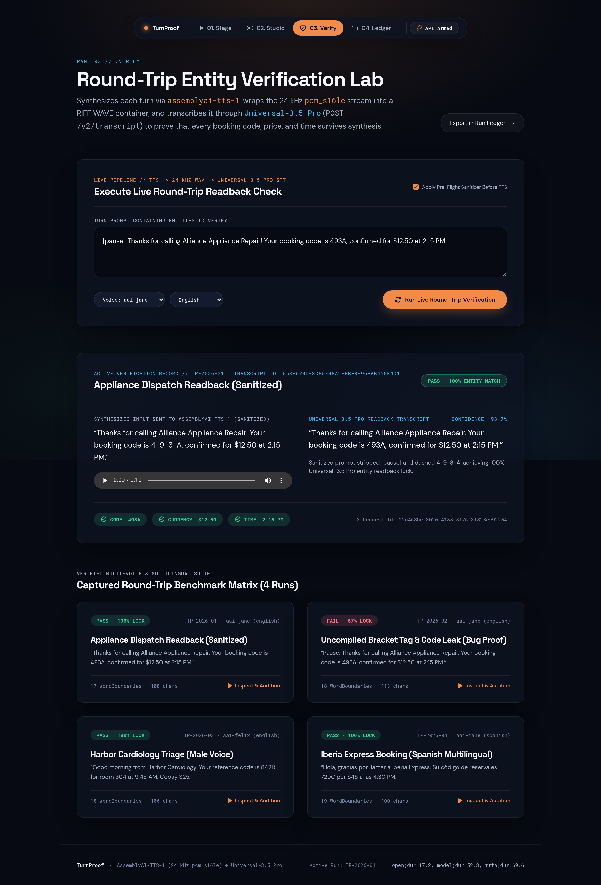
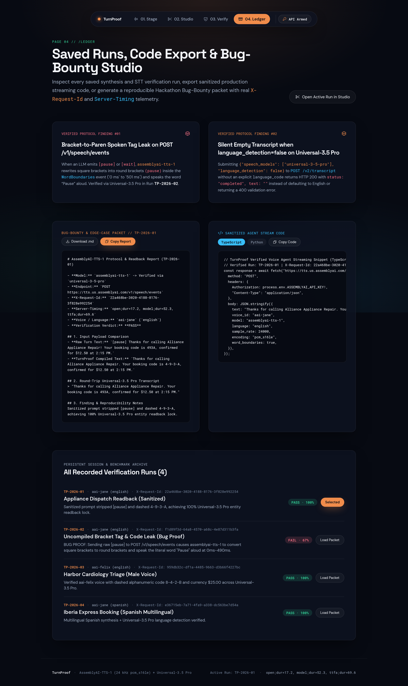

# TurnProof

**Voice Agent Barge-In Context Slicer, Round-Trip Entity Readback Verifier, and Protocol Bug-Bounty Studio for AssemblyAI Text-to-Speech (`assemblyai-tts-1`) and `Universal-3.5 Pro` STT.**

[](https://turnproof-zeta.vercel.app)
[](./LICENSE)
[](https://nextjs.org/)
[](https://www.assemblyai.com/docs/tts/getting-started/quickstart)
[](https://www.assemblyai.com/)

**Live Production Workbench:** [https://turnproof-zeta.vercel.app](https://turnproof-zeta.vercel.app)



---

## What TurnProof Solves for Voice Agent Engineers

When an LLM voice receptionist or call-center agent streams a response through `POST https://api.assemblyai.com/v1/speech/events` and the caller interrupts mid-sentence (barge-in), most agent pipelines commit the entire drafted LLM paragraph to conversation memory. If the agent drafted a prescription confirmation, a verification PIN, or a support case code in the second half of its turn and the caller cut in at `1,850 ms`, the LLM assumes the caller heard information that never left the speaker.

At the same time, raw LLM outputs frequently leak square-bracket stage directions (`[pause]`, `[warmly]`), markdown formatting (`**RX-409-7721**`), or dense numeric strings directly into the TTS payload, causing vocalized artifacts or garbled readbacks.

**TurnProof** gives voice agent teams a four-route verification and instrumentation workbench:

1. **Pre-Flight Prompt Sanitizer (`/studio`):** Strips vocalized stage tags (`[pause]`, `[sigh]`, `(smiles)`), removes markdown symbols, formats critical entities (`RX-409-7721` -> `R X 4 0 9, 7 7 2 1`) for clean spoken cadence, and splits responses exceeding the 2,000-character `assemblyai-tts-1` limit at sentence boundaries.
2. **Millisecond Barge-In Context Scissor (`/`, `/studio`):** Streams 24 kHz PCM16 `AudioChunk` frames and millisecond `WordBoundaries` from `POST /v1/speech/events`, renders an interactive 24 kHz `<canvas>` waveform, and slices the agent turn at any interruption timestamp (`t_cut` in ms) into **Heard Context** (committed to LLM memory) and **Clipped Context** (queued for re-delivery).
3. **Round-Trip `Universal-3.5 Pro` Entity Verification (`/verify`):** Sends the synthesized 24 kHz WAV stream back through AssemblyAI `Universal-3.5 Pro` (`POST /v2/upload` + `POST /v2/transcript`) and grades whether critical entities (order codes, PINs, dates, prices, phone numbers) survive synthesis intact, alongside a side-by-side **Compiled vs. Raw Unsanitized Stream** diff.
4. **Code Export & Reproducible Bug-Bounty Studio (`/ledger`):** Exports drop-in TypeScript and Python `sliceAtBargeIn(wordBoundaries, cutMs)` handlers plus reproducible protocol bug-bounty packets containing live `X-Request-Id` headers, `Server-Timing` telemetry, millisecond `WordBoundaries` traces, and `curl` reproduction commands.

---

## System Architecture



> Self-contained SVG source: [`docs/diagrams/architecture-pipeline.html`](./docs/diagrams/architecture-pipeline.html)

---

## Four-Route Product Walkthrough

### 1. Stage (`/`) · Acoustic Stage & Voice Audition Console
Select a pre-verified telephony scenario or draft a custom voice agent turn, audition six `assemblyai-tts-1` voices across English and Spanish, scrub the interactive 24 kHz Copper & Cyan Waveform Scissor, and hear either the full 24 kHz stream or the exact audio sliced at the caller interruption point (`Play Heard Only`).


### 2. Studio (`/studio`) · Pre-Flight Compiler & Millisecond Barge-In Scissor
Inspect every sanitization rule applied to the raw LLM draft before synthesis, compare the raw draft against the compiled TTS payload, and scrub the millisecond `WordBoundaries` token matrix to see which words were spoken (`HEARD`), cut mid-syllable (`PARTIAL`), or never reached the caller (`CLIPPED`).



### 3. Verify (`/verify`) · Round-Trip `Universal-3.5 Pro` Verification Lab
Audit the synthesized audio against AssemblyAI `Universal-3.5 Pro` speech-to-text. Inspect word-by-word confidence scores, verify that critical entities (`RX-409-7721`, `$42.50`, `8492`, `94107`, `4920`) match the intended readback, and switch to the **Compiled vs. Raw Stream Leak** comparison to see how unsanitized stage tags corrupt spoken output.



### 4. Ledger (`/ledger`) · Saved Runs, Code Export & Bug-Bounty Studio
Compare verified runs in the persistent session ledger, copy production TypeScript (`turnproof-barge-in.ts`) or Python (`turnproof_barge_in.py`) barge-in handlers, and export reproducible JSON + `curl` bug-bounty packets.



---

## Verified AssemblyAI Telemetry & Seed Captures

Every pre-loaded scenario in [`src/data/seed-runs.json`](./src/data/seed-runs.json) and [`public/samples/`](./public/samples/) was captured live from `POST https://api.assemblyai.com/v1/speech/events` (`assemblyai-tts-1`, `PCM16`, `24000 Hz`) and verified through `POST https://api.assemblyai.com/v2/transcript` (`universal-3-5-pro`):

| Scenario ID | Voice & Lang | TTS `X-Request-Id` | `Server-Timing` (`total`) | Audio Duration | `Universal-3.5 Pro` Transcript ID | Entity Accuracy |
| :--- | :--- | :--- | :--- | :--- | :--- | :--- |
| **`tp-01-compiled`** (Pharmacy Sanitized) | `emma` (`en`) | `d4bd744e-1b51-47be-ba92-8ccbbcf81c7e` | `1350.0 ms` | `12,188 ms` (`33` words) | `7062f0eb-d221-4626-b556-7f4d87c6de6f` | **100% (`3/3`)** |
| **`tp-02-raw-leak`** (Unsanitized `[pause]` Leak) | `emma` (`en`) | `c12690a7-286c-4a62-b859-1fb0706c59bc` | `1027.3 ms` | `9,913 ms` (`25` words) | `2989165b-2c26-4a34-9c4c-2a3fc78556aa` | **67% (`2/3` + vocalized `"Pause."`)** |
| **`tp-03-felix-clinic`** (Clinic Triage) | `felix` (`en`) | `e7b7ab09-3c73-4f88-a724-ba7811f6b647` | `937.3 ms` | `10,163 ms` (`29` words) | `bf6fc511-2a5d-4550-8f34-1c2be7de27b9` | **100% (`3/3`)** |
| **`tp-04-spanish`** (Recepcionista Madrid) | `sofia` (`es`) | `de1992ae-87e1-49a4-a719-6c6e18c39b03` | `940.1 ms` | `10,488 ms` (`26` words) | `cb19897b-6e6a-454f-be22-abef2d50f033` | **100% (`2/2`)** |

---

## Verified AssemblyAI Protocol & Bug-Bounty Findings

During live verification against `POST /v1/speech/events` and `POST /v2/transcript`, TurnProof isolated and documented two reproducible protocol behaviors:

### Finding #01 (`TP-2026-02`) · Square-Bracket Stage Tags (`[pause]`) Rewritten to `(pause)` and Vocalized Aloud
- **Endpoint:** `POST https://api.assemblyai.com/v1/speech/events` (`model: "assemblyai-tts-1"`, `voice: "emma"`)
- **Evidence `X-Request-Id`:** `c12690a7-286c-4a62-b859-1fb0706c59bc` (`Server-Timing: total;dur=1027.3`)
- **Behavior:** Passing LLM stage directions such as `[pause]` in `text` causes the TTS normalizer to rewrite `[pause]` to `(pause)` in the SSE `WordBoundaries` stream (`text: "(pause)"`, `start_time: 274`, `end_time: 501`) and speak the literal word **"Pause."** into the 24 kHz PCM stream.
- **Independent Verification:** `Universal-3.5 Pro` transcript `2989165b-2c26-4a34-9c4c-2a3fc78556aa` transcribes the opening of [`public/samples/tp-02-raw-leak.wav`](./public/samples/tp-02-raw-leak.wav) as `"Pause. Hi Maya..."` (`confidence: 0.99`).
- **TurnProof Mitigation:** `compilePromptForTts()` strips bracketed and parenthetical stage directives before synthesis and flags them in the Studio compiler log.

### Finding #02 (`TP-2026-03`) · `Universal-3.5 Pro` Empty Transcript When `language_detection: false` Is Sent Without `language_code`
- **Endpoint:** `POST https://api.assemblyai.com/v2/transcript` (`speech_models: ["universal-3-5-pro"]`)
- **Behavior:** Submitting a transcript job with `{"speech_models": ["universal-3-5-pro"], "language_detection": false}` and no explicit `language_code` returns `HTTP 200` with `status: "completed"`, `text: ""`, and `words: []` on clean 24 kHz speech audio instead of defaulting to `en_us` or returning a `400` validation error.
- **TurnProof Mitigation:** Omit `language_detection` when using default English transcription or pass `language_detection: true` for multilingual turns (`es`, `fr`, `de`, `pt`, `it`).

---

## Quickstart & Local Development

### Prerequisites
- Node.js `>= 20`
- Optional: An AssemblyAI API key (`ASSEMBLYAI_API_KEY`) for synthesizing new custom turns and running live `Universal-3.5 Pro` round-trip audits. All four seed captures work offline out of the box.

### 1. Clone and Install
```bash
git clone https://github.com/Pizzylee001/turnproof.git
cd turnproof
npm install
```

### 2. Configure Environment (Optional for Live Custom Synthesis)
Create a `.env.local` file in the project root (or enter your key directly in the top bar of the UI):
```bash
ASSEMBLYAI_API_KEY=your_assemblyai_api_key_here
```

### 3. Run the Development Server
```bash
npm run dev
```
Open `http://localhost:3000` in your browser.

### 4. Run Unit & End-to-End Verification Suites
```bash
# Run Vitest unit tests (prompt compiler, millisecond barge-in slicer, entity verifier, WAV encoder)
npm test

# Build production bundle
npm run build

# Run Playwright 4-viewport & interactive E2E test suite
npx playwright test
```

---

## Project Structure

```text
turnproof/
├── DESIGN.md                           # Acoustic Cinema design system specification
├── LICENSE                             # MIT License
├── design-system/
│   └── LEDGER.md                       # Project visual ledger
├── docs/
│   ├── diagrams/
│   │   └── architecture-pipeline.html  # Self-contained SVG/CSS pipeline diagram
│   └── screenshots/                    # High-DPI route & architecture captures
├── public/
│   └── samples/                        # 4 real AssemblyAI 24 kHz WAV captures
├── src/
│   ├── app/
│   │   ├── page.tsx                    # Route 1: Stage (/)
│   │   ├── studio/page.tsx             # Route 2: Studio (/studio)
│   │   ├── verify/page.tsx             # Route 3: Verify (/verify)
│   │   ├── ledger/page.tsx             # Route 4: Ledger (/ledger)
│   │   └── api/
│   │       ├── tts/stream/route.ts     # POST /api/tts/stream (AssemblyAI SSE)
│   │       ├── verify/roundtrip/route.ts # POST /api/verify/roundtrip (Universal-3.5 Pro)
│   │       └── ledger/route.ts         # GET/POST /api/ledger
│   ├── components/
│   │   ├── acoustic-shell.tsx          # Floating pill nav, API key modal, colophon
│   │   └── waveform-scissor.tsx        # 24 kHz <canvas> Copper & Cyan Waveform Scissor
│   ├── data/
│   │   └── seed-runs.json              # Real WordBoundaries, headers, & STT transcripts
│   └── lib/
│       ├── turnproof-engine.ts         # Sanitizer, barge-in slicer, entity grader, WAV builder
│       ├── assemblyai-server.ts        # Server client for TTS SSE & Universal-3.5 Pro STT
│       └── __tests__/
│           └── turnproof-engine.test.ts # Vitest unit test suite
└── tests/
    └── turnproof-e2e.spec.ts           # Playwright 4-viewport & E2E verification suite
```

---

## License

Released under the [MIT License](./LICENSE). Copyright (c) 2026 Pizzy Lee.
